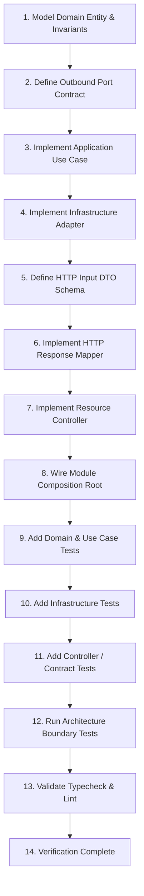

# API Feature Development Workflow Guide

This document outlines the **step-by-step engineering workflow** for implementing a new feature in `apps/api` following Clean Architecture and Hexagonal boundaries.

---

## 1. The 14-Step Feature Implementation Workflow



---

## 2. End-to-End Walkthrough Example: `CreateListing`

Follow this reference example from domain to HTTP endpoint.

### Step 1: Model the Domain (`src/domain/listings/listing.ts`)
Define the entity, enums, and domain invariants without any external framework dependencies.

```typescript
// src/domain/listings/listing.ts
import type { Centavos } from '@/domain/shared/money.ts';
import type { OrganizationId } from '@/domain/shared/organization-scope.ts';

export type ListingKind = 'LONG_TERM' | 'SHORT_TERM';
export type ListingState = 'DRAFT' | 'PUBLISHED' | 'UNPUBLISHED' | 'ARCHIVED';

export interface Listing {
  readonly id: string;
  readonly organizationId: OrganizationId;
  readonly resourceId: string;
  readonly kind: ListingKind;
  readonly title: string;
  readonly description: string;
  readonly priceCentavos: Centavos;
  readonly state: ListingState;
  readonly amenities: readonly string[];
  readonly houseRules: readonly string[];
  readonly terms: readonly string[];
  readonly minStayNights: number | null;
  readonly advanceMonths: number;
  readonly depositMonths: number;
  readonly photos: readonly string[];
}
```

---

### Step 2: Define the Outbound Port (`src/application/ports/repositories/listing-repository.port.ts`)
Define the abstract contract required by the application.

```typescript
// src/application/ports/repositories/listing-repository.port.ts
import type { Listing, ListingKind } from '@/domain/listings/listing.ts';
import type { Centavos } from '@/domain/shared/money.ts';

export interface CreateListingInput {
  readonly organizationId: string;
  readonly resourceId: string;
  readonly kind: ListingKind;
  readonly title: string;
  readonly description: string;
  readonly priceCentavos: Centavos;
  readonly amenities: readonly string[];
  readonly houseRules: readonly string[];
  readonly terms: readonly string[];
  readonly minStayNights: number | null;
  readonly advanceMonths: number;
  readonly depositMonths: number;
  readonly photos: readonly string[];
}

export interface ListingRepository {
  createListing(input: CreateListingInput): Promise<Listing>;
  findById(organizationId: string, listingId: string): Promise<Listing | null>;
  forOrganization(organizationId: string): Promise<readonly Listing[]>;
}
```

---

### Step 3: Implement the Application Use Case (`src/application/listings/create-listing/create-listing.use-case.ts`)
Orchestrate domain invariants and application authorization.

```typescript
// src/application/listings/create-listing/create-listing.use-case.ts
import type { ListingRepository } from '@/application/ports/repositories/listing-repository.port.ts';
import type { Listing, ListingKind } from '@/domain/listings/listing.ts';
import type { Centavos } from '@/domain/shared/money.ts';
import type { Principal } from '@/domain/identity/identity.ts';
import { assertMayManageOrganization } from '@/application/identity/application-authorization.rules.ts';

export interface CreateOwnerListingInput {
  readonly principal: Principal;
  readonly organizationId: string;
  readonly resourceId: string;
  readonly kind: ListingKind;
  readonly title: string;
  readonly description: string;
  readonly priceCentavos: Centavos;
  readonly amenities: readonly string[];
  readonly houseRules: readonly string[];
  readonly terms: readonly string[];
  readonly minStayNights: number | null;
  readonly advanceMonths: number;
  readonly depositMonths: number;
  readonly photos: readonly string[];
}

export const createListing =
  (listings: ListingRepository) =>
  async (input: CreateOwnerListingInput): Promise<Listing> => {
    // 1. Authorize principal
    assertMayManageOrganization(input.principal, input.organizationId);

    // 2. Delegate persistence to port
    return listings.createListing({
      organizationId: input.organizationId,
      resourceId: input.resourceId,
      kind: input.kind,
      title: input.title,
      description: input.description,
      priceCentavos: input.priceCentavos,
      amenities: input.amenities,
      houseRules: input.houseRules,
      terms: input.terms,
      minStayNights: input.minStayNights,
      advanceMonths: input.advanceMonths,
      depositMonths: input.depositMonths,
      photos: input.photos,
    });
  };
```

---

### Step 4: Implement Infrastructure Adapter (`src/infrastructure/postgres/repositories/postgres-listing.repository.ts`)
Implement SQL queries inside the database repository adapter with RLS transaction scoping.

```typescript
// src/infrastructure/postgres/repositories/postgres-listing.repository.ts
import type {
  CreateListingInput,
  ListingRepository,
} from '@/application/ports/repositories/listing-repository.port.ts';
import type { Listing } from '@/domain/listings/listing.ts';
import { sql, withScope } from '@/infrastructure/postgres/db.ts';

export const postgresListingRepository = (): ListingRepository => ({
  async createListing(input: CreateListingInput): Promise<Listing> {
    return withScope(input.organizationId, async (tx) => {
      const [row] = await tx`
        INSERT INTO listings (
          organization_id, resource_id, kind, title, description, price_centavos
        ) VALUES (
          ${input.organizationId}, ${input.resourceId}, ${input.kind},
          ${input.title}, ${input.description}, ${input.priceCentavos}
        )
        RETURNING *
      `;
      return mapRowToListing(row);
    });
  },
  // ... other methods
});
```

---

### Step 5: Define HTTP DTO (`src/modules/listings/dto/owner-listing.dto.ts`)
Validate HTTP transport bodies with Zod.

```typescript
// src/modules/listings/dto/owner-listing.dto.ts
import { z } from 'zod';

export const createListingSchema = z.object({
  resourceId: z.guid(),
  kind: z.enum(['LONG_TERM', 'SHORT_TERM']),
  title: z.string().trim().min(3).max(120),
  description: z.string().trim().max(4000).default(''),
  priceCentavos: z.number().int().nonnegative(),
  amenities: z.array(z.string().trim()).default([]),
  houseRules: z.array(z.string().trim()).default([]),
  terms: z.array(z.string().trim()).default([]),
  minStayNights: z.number().int().positive().nullable().optional(),
  advanceMonths: z.number().int().nonnegative().default(0),
  depositMonths: z.number().int().nonnegative().default(0),
  photos: z.array(z.string().trim()).default([]),
});

export type CreateListingDto = z.infer<typeof createListingSchema>;
```

---

### Step 6: Define HTTP Mapper (`src/modules/listings/mappers/listing-http.mapper.ts`)
Map domain entities to HTTP presentation responses.

```typescript
// src/modules/listings/mappers/listing-http.mapper.ts
import type { Listing } from '@/domain/listings/listing.ts';

export function toListingHttpResponse(listing: Listing) {
  return {
    id: listing.id,
    organizationId: listing.organizationId,
    resourceId: listing.resourceId,
    kind: listing.kind,
    title: listing.title,
    description: listing.description,
    priceCentavos: listing.priceCentavos,
    state: listing.state,
    photos: listing.photos,
  };
}
```

---

### Step 7: Implement HTTP Controller (`src/modules/listings/controllers/owner-listings.controller.ts`)
Inbound HTTP adapter handling transport routing, validation, principal extraction, and mapping.

```typescript
// src/modules/listings/controllers/owner-listings.controller.ts
@Controller('organizations/:organizationId')
export class OwnerListingsController {
  constructor(
    @Inject(CREATE_LISTING)
    private readonly createListingUseCase: ReturnType<typeof createListing>,
    @Inject(RESOLVE_PRINCIPAL)
    private readonly resolve: ReturnType<typeof resolvePrincipal>,
  ) {}

  @Post('listings')
  async createListing(
    @Param('organizationId') organizationId: string,
    @Body() rawBody: unknown,
    @Headers('authorization') auth?: string,
  ) {
    const parsed = createListingSchema.safeParse(rawBody);
    if (!parsed.success) {
      throw new BadRequestException(parsed.error.issues[0]?.message ?? 'Invalid listing data');
    }

    const principal = await this.resolve({ authorization: auth, organizationId });
    const created = await this.createListingUseCase({
      principal,
      organizationId,
      ...parsed.data,
      priceCentavos: centavos(parsed.data.priceCentavos),
      minStayNights: parsed.data.minStayNights ?? null,
    });

    return toListingHttpResponse(created);
  }
}
```

---

### Step 8: Wire Composition Root (`src/modules/listings/listings.module.ts`)
Bind repository adapter to port token and inject into use case.

```typescript
// src/modules/listings/listings.module.ts
@Module({
  controllers: [OwnerListingsController],
  providers: [
    {
      provide: LISTING_REPOSITORY,
      useFactory: (): ListingRepository => postgresListingRepository(),
    },
    {
      provide: CREATE_LISTING,
      inject: [LISTING_REPOSITORY],
      useFactory: (repo: ListingRepository) => createListing(repo),
    },
    // ...
  ],
})
export class ListingsModule {}
```

---

## 3. Mandatory Quality & Testing Gates

Run all quality checks before committing or finishing a task:

```bash
npm run typecheck    # 1. Zero TypeScript compilation errors
npm run lint         # 2. Zero ESLint warnings / errors
npm test             # 3. Unit, Contract, and Architecture tests (all 28 rules passing)
```
